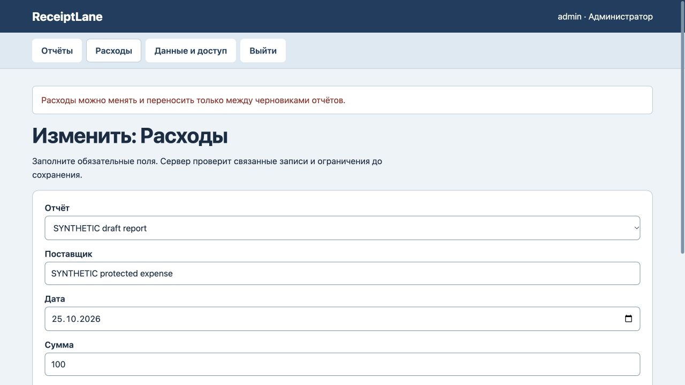
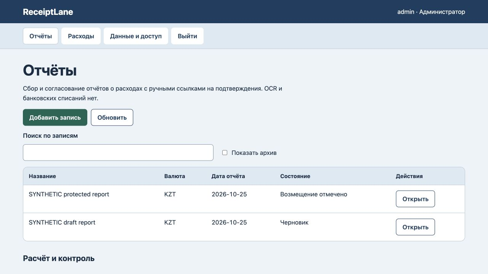

# ReceiptLane: сохранность согласованных расходов

25 октября 2026. На прежнем коде воспроизведён перенос расхода из отправленного, согласованного и отмеченного как возмещённый отчёта в другой черновик: исходный итог уменьшался с 200 до 100, итог черновика рос с 50 до 150. Регрессионный тест сначала завершился ошибкой. Это дефект нашей реализации, не утверждение о референсе.

Исправлена проверка исходного отчёта и назначения. Перенос, правка суммы или подтверждения и архивирование расхода требуют черновиков. Отдельный разрешённый возврат отправленного/согласованного отчёта в черновик сохраняется; отмеченное возмещение остаётся неизменным. Перенос между черновиками также проверен.

Все 5 тестов прошли, включая три защищённых статуса, отказы с неизменными данными/итогами/версией/журналом, файловый перезапуск, восстановление и независимое согласование. В браузере отказ переноса сохранил оба итога 200/50, все записи, версию 8 и 8 событий журнала. Разрешённая правка расхода черновика с 50 до 75 дала версию 9 и 9 событий; исходный отчёт и его расход не изменились. После обновления страницы видны итоги 200/75 и пометка, что возмещение — ручная учётная отметка, не банковская операция. [Машинная проверка](protected-expenses-verification.json).

Сервер проверен локально. Новое размещение, OCR, загрузки чеков, банковские операции и бухгалтерские интеграции не добавлены. Прежние ошибочные изменения автоматически не исправляются: нужна ручная сверка. Новый полный аудит интерфейса или безопасности не проводился.
